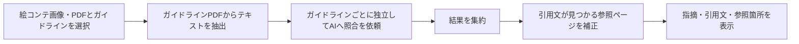

# CM考査支援システム

## 概要

CMの絵コンテを、選択した業種別ガイドラインのPDFと照合し、AIによる指摘、引用文、参照ページを担当者が確認できるようにするデモです。4段階の手順（ガイドライン精読→絵コンテとの照合→重複統合→最終判定）をプロンプトで指定し、結果として指摘と根拠を表示します。画面は各段階の実際の進捗を取得していません。

## 背景と課題

学部のテレビ局向け企業連携PBLで、考査業務を人力で行うことによる担当者の工数と判断の属人性が課題でした。約1か月で、絵コンテと法規制・放送基準の照合を支援する仕組みを開発しました。

## 本人の役割

技術リーダーとして設計と開発を進めました。実装には、生成AIを活用しました。

## 今の段階

デモ提供まで実施し、「企業価値がある」との評価を受けました。一方で判定精度には課題が残っています。実運用には、継続的な精度検証と改善が必要です。AIの出力は考査の確定判断ではありません。

## 処理の流れ



バックエンドはFastAPI、画面はReact・TypeScript・Viteを使用し、判定にはGemini 2.5 Flash APIを使用しています。複数のガイドラインを選んだ場合は、PDFごとに照合して結果を集約します。

## 工夫した点

- **長い資料の見落とし**：複数の資料をまとめて渡すと、AIが長い入力の中ほどを見落とす問題（lost-in-the-middle）がありました。ガイドラインごとに独立して処理する設計に変更しました。プロンプト内では4段階の手順を指定しています。
- **存在しないページ番号の参照**：AIが誤ったページ番号を挙げることがありました。PDFの抽出テキストから引用文を探し、見つかった場合は、その位置のPDFページ番号とページ内の区分に参照を書き換える事後処理を入れました。引用文を見つけられない場合は自動補正できないため、原本での確認が必要です。

## 評価と限界

デモに対する評価は得られましたが、判定精度を定量的に実証できた段階ではありません。画像やスキャンPDFの読み取り、引用文の抽出、AIの判断には誤りがあり得ます。表示された指摘と根拠は担当者が原本と照合する前提です。公開している `guidelines/sample_guideline.pdf` はタイトルのみのダミーで、実際の考査には使えません。

## セットアップ

PythonとNode.jsが必要です。以下は開発環境での起動例です（依存関係の導入とGemini APIキーの設定には各自の環境が必要です）。

```powershell
cd backend
python -m venv .venv
.venv\Scripts\python -m pip install -r requirements.txt
Copy-Item .env.example .env
# .env の GEMINI_API_KEY を自身のキーに変更
.venv\Scripts\python main.py
```

別のターミナルで画面を起動します。

```powershell
cd frontend
npm ci
npm run dev
```

画面の接続先は既定で `http://localhost:8000`、Viteの開発画面は `http://localhost:5173` です。内容のある照合を試す場合は、公開してよい自作のダミー規則PDFを `guidelines/` に置いてください。実際のキーや非公開のガイドラインは公開リポジトリに追加しないでください。

## 環境変数

| 変数 | 場所 | 用途 |
| --- | --- | --- |
| `GEMINI_API_KEY` | `backend/.env` | Gemini APIへの接続。`.env.example` はダミー値です。 |
| `VITE_API_BASE` | フロントエンドの環境 | APIの接続先。未設定時は `http://localhost:8000`。 |
| `PORT` | バックエンドの環境 | APIの待受ポート。未設定時は `8000`。 |

## 今後

実際の考査担当者による検証を重ね、見落とし・誤検出・引用の誤りを記録して判定精度を改善します。特に、引用文を見つけられない場合の扱いと、スキャンPDFへの対応が課題です。
